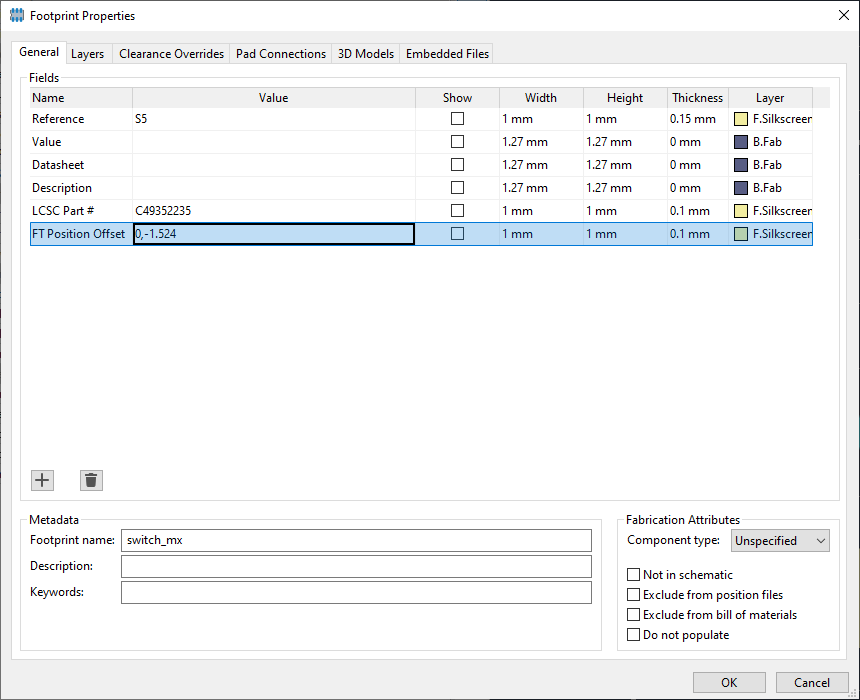
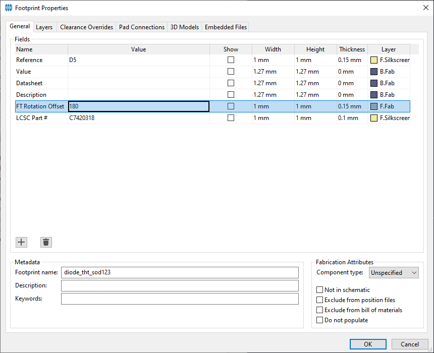
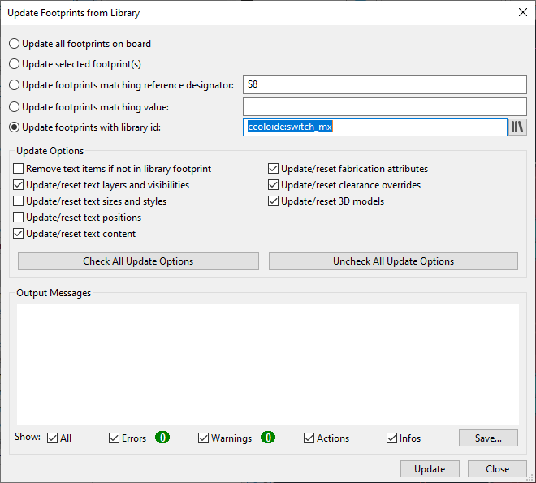
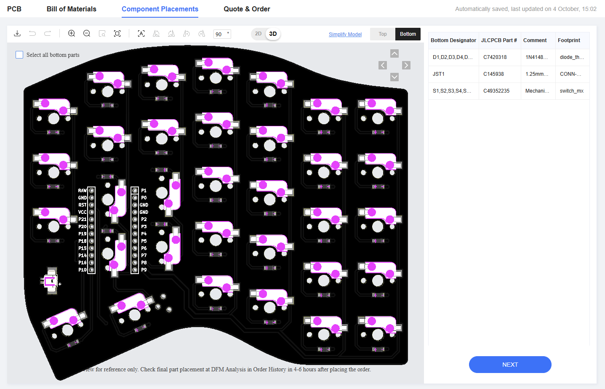

# Notes
These are little notes to myself that I found useful (and because if I don't write them down I'll forget them). Sharing these in case they may be helpful to someone else.
- [How to View These PCBs With Their 3D Models in KiCad](#how-to-view-these-pcbs-with-their-3d-models-in-kicad)
- [Refining Ergogen Board Outlines in Fusion](#refining-ergogen-board-outlines-in-fusion)
- [How to Import SVG for Board Outline in KiCad](#how-to-import-svg-for-board-outline-in-kicad)
- [Fixing Part Positions and Rotations with Fabrication-Toolkit](#fixing-part-positions-and-rotations-with-fabrication-toolkit)

## How to View These PCBs With Their 3D Models in KiCad
Clone/download this repo and note down your local path to the /kicad/easyeda2kicad/ directory.

In KiCad, go to `Preferences` -> `Configure Paths...`. Add a new Environment Variable named `EASYEDA2KICAD` with your local easyeda2kicad/ directory path.

Next, go to `Preferences` -> `Manage Footprint Libraries...`. Add the paths to the easyeda2kicad.3dshapes/ and easyeda2kicad.pretty/ directories.

Next, go to `Preferences` -> `Manage Symbol Libraries...` and add the path to the `easyeda2kicad.kicad_sym` file.

Restart KiCad, then open the PCB files. Click on `3D Viewer` to view the PCB with all its models.

## Refining Ergogen Board Outlines in Fusion

I wanted a curved edge to my PCBs (and key plate) but couldn't find an easy way to do it through KiCad or Ergogen. Turns out you can make the outline in CAD software and then import it into KiCad.

I took the Ergogen DXFs of the board and plate outlines for one side (`board_left.dxf` and `plate_left.dxf`), created a new part in Fusion, created a sketch for each, then imported the DXFs into their respective sketches. I imported both DXFs because I wanted to easily compare them and make sure my new board edges would not interfere with the switch footprints.

Next, I added a few free-floating reference points above certain key cutouts Then added sketch dimensions from the key to its respective point, setting the dimension to 3.525 mm to match the outer edge widths of the key plate. I didn't want my new curve to go lower than this as I was worried it would make the key plate edges too bendy/fragile. I also needed the space for my PCB routes.

Then I used the Fit Point Spline to create my curved lines. At some points, such as the top corners, the filleted areas needed to be redone to match the new spline. 

Once I was happy, I exported the modified `plate_left` sketch as a DXF for future Fusion use. I then copypasted the plate sketch into a new sketch and removed the key cutouts. 

How to Copypaste Fusion Sketches within the Same File

Edit the sketch that you want to copy from. 

Drag a selection over the entire sketch and `CTRL + C` to copy.

Click `Finish Sketch` to end editing the sketch. 

Then, edit the sketch that you want to paste in. `CTRL + V` to paste your previous selection. Make sure sketch is appropriately aligned.

I exported the DXF for use as my new `board_left.dxf`. Finally, using Fusion's Shaper Utilities plugin, I exported an SVG for use in KiCad.

## How to Import SVG for Board Outline in KiCad

In KiCad, go to `File` > `Import` > `Graphics`. I selected my SVG and set the import layer to `User.4`. Place it somewhere on the side. I'm placing this outline on the User.4 layer first because I'm using this as a placeholder outline to align my edge cut that's coming up. 

Next, I selected the imported polygon, all the segments should be highlighted, and set the line width to 0.15 mm to match the Ergogen-generated edge cut outline.

On the right, I select the `Edge.Cuts` layer so it's active. Then clicked on the imported polygon and pressed `M` to begin moving it. Move it over the existing outline and it should snap to position right over it (you should see the crosshair icon on the cursor). If it's not snapping, try it at one of the corners.

With the `Edge.Cuts` layer still active, go to `Edit` > `Global Deletions`. Check the box for `Board Outline` and select `Current layer (Edge.Cuts) only`. Click OK and your existing board outline should be deleted.

Import the SVG again but this time choose the `Edge.Cuts` layer.

Update the line widths for this polygon to 0.15 mm like before.

Set the `User.4` layer as active and then move your new board outline over until it snaps onto the `User.4` outline.

Once again, go to `Global Deletions`. Check the box for `Graphics` and select the current layer (`User.4`). Click OK and the placeholder board outline is deleted.

Your new board outline is now in place on the `Edge.Cuts` layer. Refill ground zones and run DRC to verify.

## Fixing Part Positions and Rotations with Fabrication-Toolkit

The Fabrication-Toolkit plugin was used to generate the gerbers, BOMs, and component position files for the boards. These were uploaded to JLCPCB and their 3D Component Placement viewer gives a preview of the parts placement. To my surprise all of the hotswap sockets were misaligned and the diodes had their orientations reversed.

I used the preview to determine my X/Y offsets. The plugin's readme states that every arrow click is equal to 0.0635mm. For the 0° hotswap sockets, I had to click on the Up arrow 24 times to get them aligned. 

This results in: `24 * 0.0635mm = 1.524`

Since this is UP on the Y-axis, the offset for the hotswap sockets is `(0, -1.524)`.

This was the only offset I needed to apply to the sockets to correct them. This same offset worked for the 90° and -24° rotated sockets.

The diodes had a reverse orientation which needed a `180` rotation offset.

To apply these offsets for Fabrication-Toolkit, I opened my PCB files, right-clicked the desired footprint and opened the footprint editor. To be able to apply these changes in bulk across both boards, I created a new footprint library named `ceoloide`, made it a global library, and saved a copy of the `switch_mx` and `diode_tht_sod123` footprints to it. 

In the `switch_mx` footprint editor, go to its properties and add a new General field named `FT Position Offset`. Set the value to `0,-1.524`.

Do the same with `diode_tht_sod123`, add a new General field named `FT Rotation Offset`. Set the value to `180`.

Save changes and exit the footprint editor.

On the PCB, select one of the switch footprints to highlight it, then right-click and select `Update Footprint...`

Check the radio button for `Update footprints with library id:` and verify the text field shows `ceoloide:switch_mx`. Check the boxes for `Update/reset text layers and visibilities` and `Update/reset text content`. Click Update and this should update all your switch footprints with the new `FT Position Offset` field.

Repeat for the diode footprints.

Finally, regenerate your component position files with Fabrication-Toolkit. Re-upload them to JLCPCB and verify that the parts orientations and rotations are now correct.

